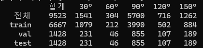
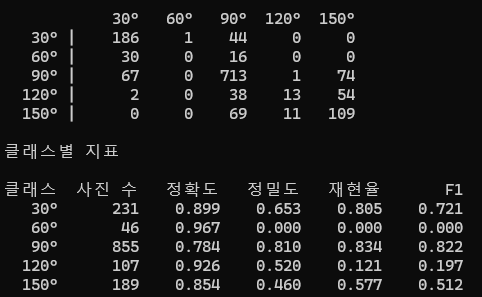
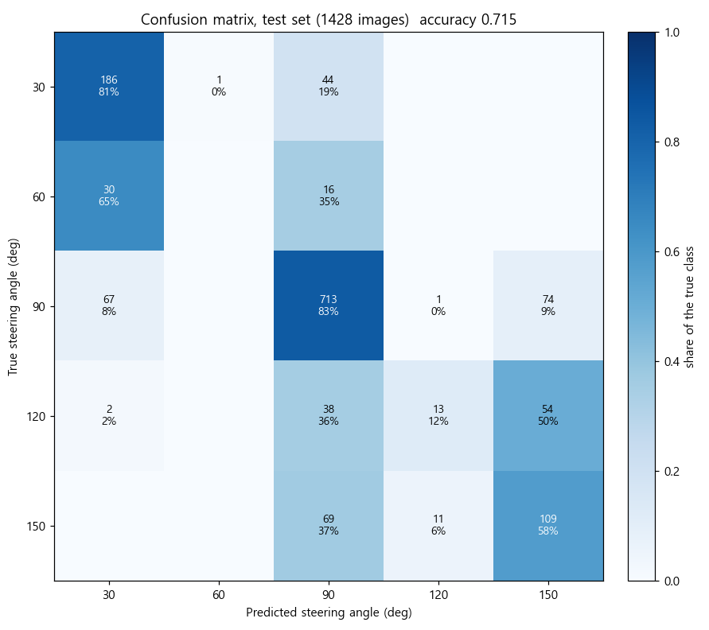
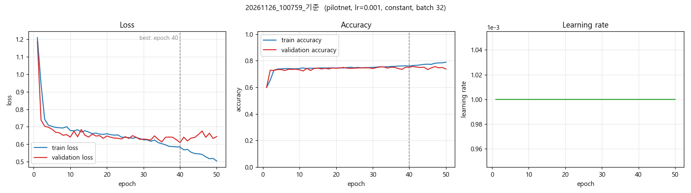

# Auto-Drive AI Car

2026-11-25
Machine Learning Test
- 2026_11_24의 dataset으로 지도학습 테스트

- 기본 설정
    -   epochs: 50  
    -   batch_size: 32  



- 결과






- 소감
```text
대부분의 사진이 90° 걱정되었지만 의외의 결과로 30°, 150°도 정확성이 높게 나온 점이 이해가 되지 않고 60°, 120°의 dataset의 결과가 부족한 점에 대해 아쉬움이 남았다

다음 dataset은 60°, 120°의 data를 보충하고 90°와의 균형을 맞추는 것을 목표로 수집을 목표, 30°, 150°의 data의 수가 적지만 정확성이 높게 나온 이유를 분석해보고 싶다
```